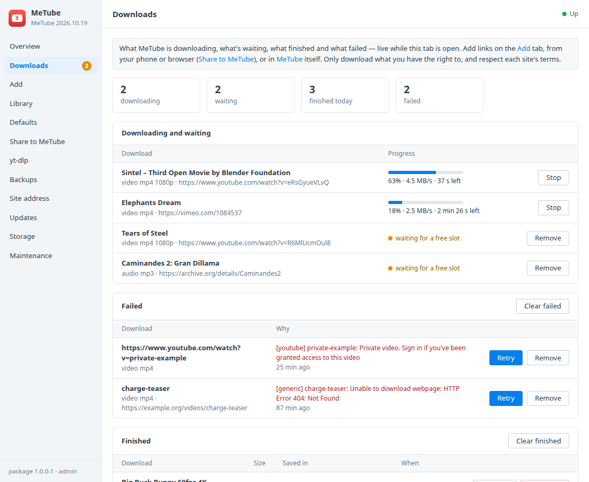
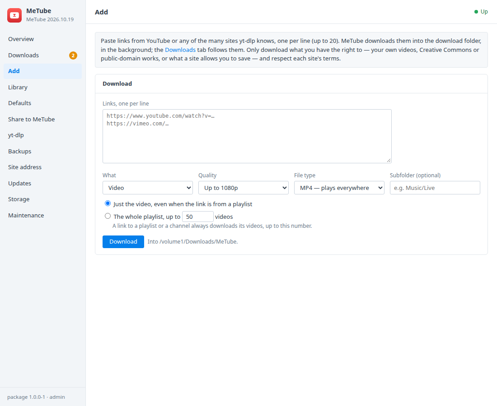
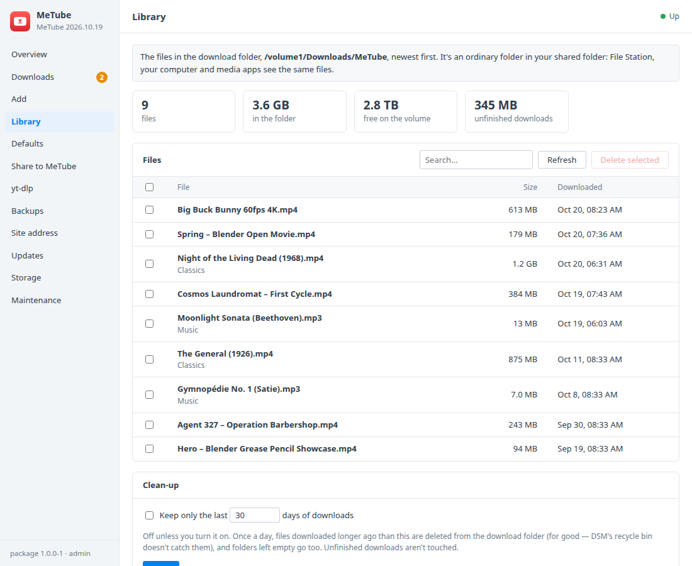
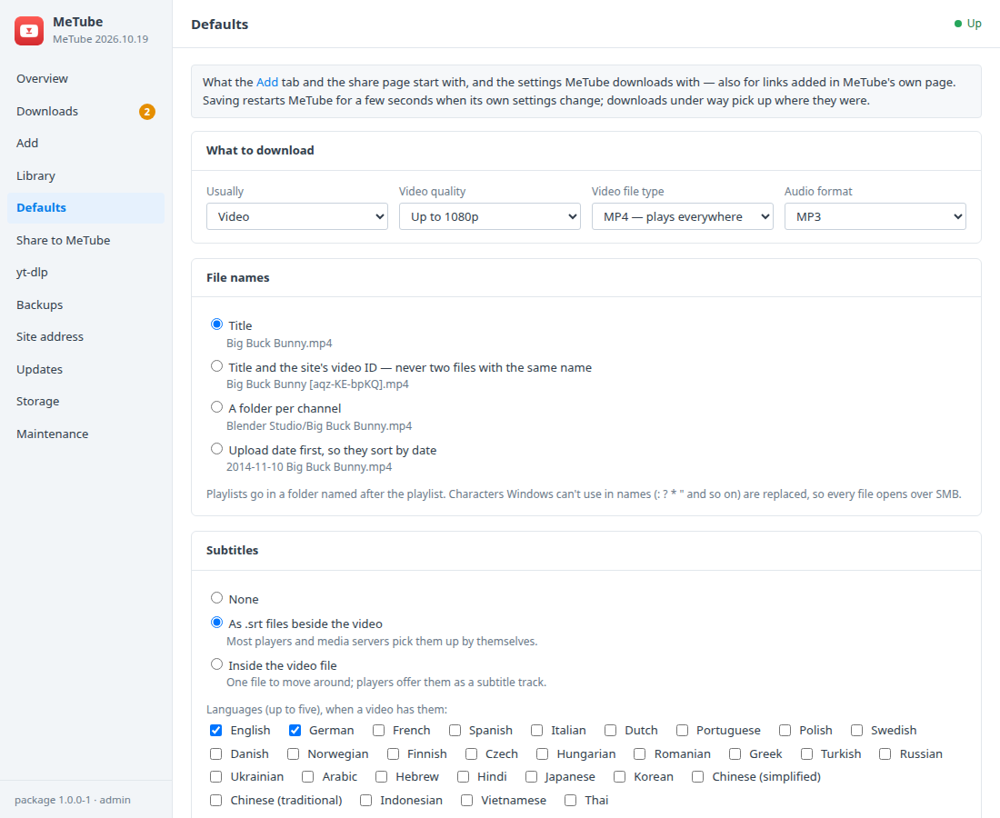
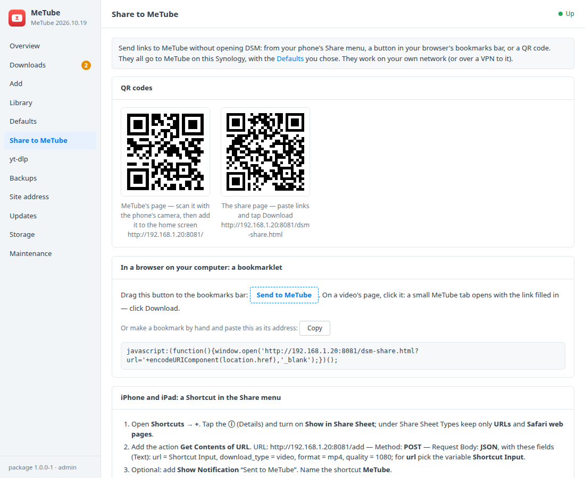
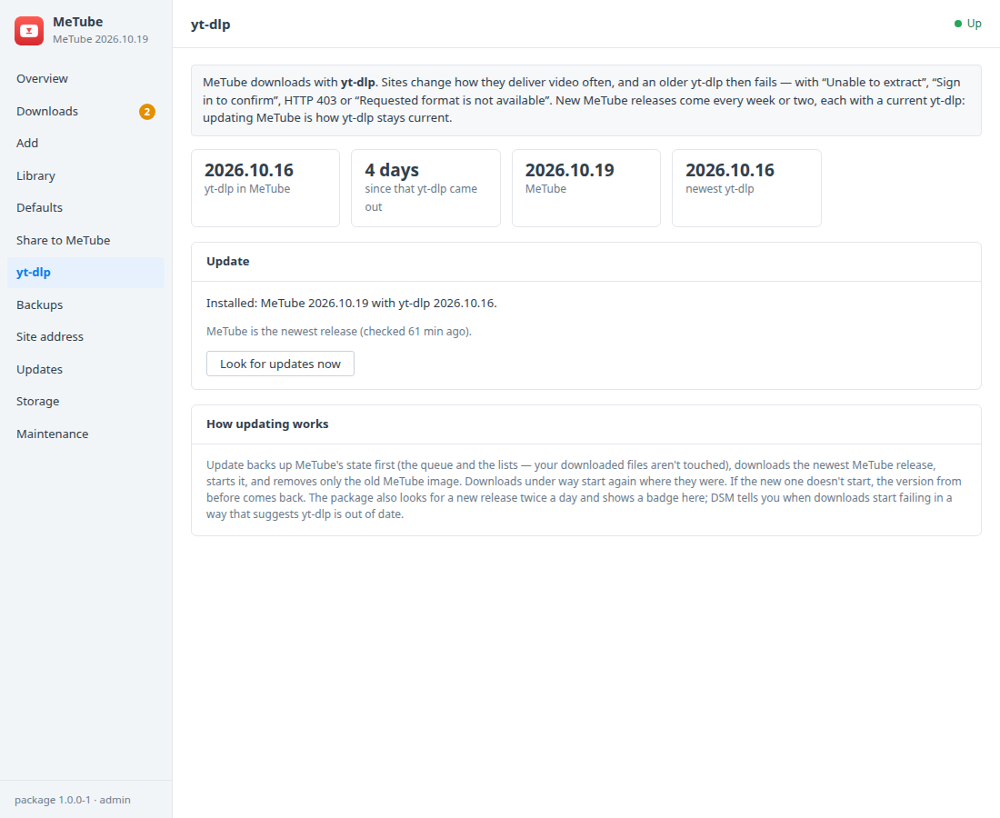

# MeTube for Synology DSM

A DSM 7 package that installs [MeTube](https://github.com/alexta69/metube) in
Container Manager. MeTube is a web page for [yt-dlp](https://github.com/yt-dlp/yt-dlp):
paste a link from YouTube or one of the many other sites yt-dlp knows, and it
downloads the video, or just the audio, into a shared folder on your Synology.
A DSM window adds:
- the queue with progress, speed and time left, live; finished downloads with
  where they were saved; failed ones with the plain reason and **Retry**;
- adding several links at once, with quality, audio only, a subfolder and
  playlist handling;
- the download folder's files with sizes and dates, free space, deleting, and
  an optional "keep only the last N days" clean-up;
- defaults for quality, safe file name patterns, subtitles, cover art and
  metadata, and how many downloads run at once;
- sending links from a phone or browser: a bookmarklet, an iPhone Shortcut,
  Android steps and QR codes;
- yt-dlp's version and age, and an update to the newest MeTube release when
  sites change and downloads start failing;
- DSM notifications, backups of MeTube's state, and updates.

**Only download what you have the right to** — your own videos, Creative
Commons or public-domain works, or what a site allows you to save — and
respect each site's terms.

Built on the [DSM app chassis](https://github.com/tombruton87/dsm-app-chassis).

## Download

### **[⬇ Download metube.spk](https://github.com/tombruton87/metube-dsm/releases/latest/download/metube.spk)**

[](https://github.com/tombruton87/metube-dsm/releases/latest)

That link always gives the newest version. Older ones are on the
[Releases](https://github.com/tombruton87/metube-dsm/releases) page.

Install: Package Center → Manual Install → the `.spk` (DSM 7.2.1+; Container
Manager is installed first if missing). The wizard asks for the NAS's address,
a port for MeTube's page (8081 by default, or a free one), a time zone and the
download folder — a folder inside a shared folder, `/volume1/Downloads/MeTube`
when you have a `Downloads` share.

**The download folder and permissions.** MeTube runs as the package's own
user, `metube`, so the files it saves belong to that user. The package makes
the last folder (`MeTube`) inside the shared folder if it may, but never makes
a shared folder: create `Downloads` first in **Control Panel → Shared Folder**
if you don't have one. Give the package Read/Write on it: **Control Panel →
Shared Folder → Downloads → Edit → Permissions → "System internal user" in the
drop-down → metube → Read/Write**. The window tests this by writing a file as
that user, and shows these steps when it can't; adding links waits until it
can. The folder can be changed later on the Defaults tab.

**No sign-in.** MeTube's own page has no accounts: anyone who can reach it can
start downloads. Keep it on your own network, or put it behind DSM's reverse
proxy with HTTPS and an access control profile (steps on the Site address
tab). The DSM window itself is behind DSM's sign-in, for administrators.

## What the DSM window adds

- **Overview** — in the queue, downloading, finished today, and the download
  folder's size.
- **Downloads** — live while the tab is open (every two seconds):
  - Downloading and waiting: progress, speed and time left; waiting for a free
    slot or for Start; Stop or remove.
  - Failed: the reason in yt-dlp's words (404, “Sign in to confirm”, “Unable to
    extract”…), when, **Retry** and Remove. Clear failed.
  - Finished: title, file name, size, the folder it was saved in and when;
    remove from the list, or **Delete file** as well. Clear finished (the
    files stay).
- **Add** — links, one per line (up to 20); video (best, or up to
  2160p/1080p/720p/480p; MP4 or best available) or audio only (MP3, M4A,
  Opus); an optional subfolder (suggested from the existing ones); just the
  video, or the whole playlist up to N videos. Every value is checked in the
  CGI and again in the setup container: only `http://` and `https://` links,
  length limits, subfolders of plain names without `..` or hidden parts.
- **Library** — the newest 500 files in the download folder, with size and
  date, a search, the total size, free space on its volume and unfinished
  downloads; select and **delete**. **Clean-up** (off by default): keep only
  the last N days of downloads, applied once a day, removing folders left
  empty. Files get the date they were downloaded, not the upload date, so the
  clean-up and the list go by when you got them.
- **Defaults**
  - What the Add tab and the share page start with: video or audio, quality,
    MP4 or best available, audio format.
  - **File names**, as safe presets (never free text): title; title and video
    ID; a folder per channel; upload date first. Playlists go in a folder of
    their own. Names are made safe for Windows and SMB (no `: ? * "`).
  - **Subtitles**: none, as `.srt` files beside the video, or inside the video
    file; up to five languages; automatic subtitles too, if you like.
  - Cover art in MP4 and audio files, title/artist/date metadata, how many
    downloads at once (1-5), and whether links to addresses on your own
    network are allowed (off by default, MeTube's guard).
  - The download folder, with the permission check and DSM's steps to fix it.
  - DSM notifications: a download failed (on), a download finished (off).
- **Share to MeTube** — QR codes for MeTube's page and for a small share page
  MeTube serves (paste links, tap Download); a **bookmarklet** that opens it
  with the current page's link filled in; an **iPhone/iPad Shortcut** for the
  Share menu, with the exact URL and JSON fields for this NAS; **Android**
  steps (home-screen share page, or MeTube's own app in the Share menu once
  it's on HTTPS).
- **yt-dlp** — the yt-dlp version inside MeTube and how old it is, the newest
  yt-dlp and MeTube releases, and **Update**: a backup of MeTube's state, the
  newest MeTube release from ghcr.io (each brings a current yt-dlp), and only
  the old MeTube image removed. When two or more downloads fail in a day with
  the errors an outdated yt-dlp gives, DSM says so.
- **DSM notifications** for failed downloads, finished ones (optional), and
  yt-dlp going out of date.
- **Backups, updates, storage, maintenance** — backups hold MeTube's state
  (the queue, finished and failed downloads, subscriptions, an uploaded
  cookies file), not your downloaded media: that's in your shared folder, for
  Hyper Backup. Nightly or on demand, with restore. A newer package from
  inside DSM, a redacted support report, the logs, and removing MeTube with
  its state (your downloads stay).

## Screenshots

| | |
|---|---|
|  |  |
|  |  |
|  |  |

## How it works

MeTube (`ghcr.io/alexta69/metube`, pinned to a release) runs as one container,
as the package's user (compose `user:`), so it never changes ownership of
anything. Its state is in the `metube_state` volume. The download folder is
bind-mounted at `/downloads` with `create_host_path: false`; unfinished
downloads are kept in a hidden `.incomplete` folder beside it, so finishing one
is a rename. While the folder is missing or not writable an empty placeholder
stands in and the window says why.

The package adds, retries, starts and removes downloads through MeTube's own
API (`/add`, `/retry`, `/start`, `/delete`, `/history`) from the setup
container; the window's Downloads tab reads `/history` directly for live
progress. Defaults become MeTube's environment: `OUTPUT_TEMPLATE`,
`MAX_CONCURRENT_DOWNLOADS`, `ALLOW_PRIVATE_ADDRESSES`, and `YTDL_OPTIONS`
(subtitles, metadata, Windows-safe names, `updatetime: false`). Cover art for
MP4 is a `YTDL_OPTIONS_PRESETS` preset the window applies to MP4 downloads
only, since yt-dlp can't embed a thumbnail in WebM; audio uses MeTube's own
cover option. The share page is a static file bind-mounted into MeTube's web
root, so its requests to `/add` come from MeTube's own origin; links arriving
there fill the box and download on a tap, never by themselves.

The library is listed and cleaned inside MeTube's container as the package's
user. Updates compare the pinned tag with MeTube's latest GitHub release and
check that its image is on ghcr.io; updating moves the tag after a backup and
removes the old image by name (no host-wide prune).

## Layout

```
chassis/          the DSM app chassis (git submodule)
package.conf      name, title, services, volumes, images, ports, texts
app/compose.yaml  MeTube, with the download folder and the share page mounted
setup/app.sh      the hooks: the download folder and its permission, defaults, downloads through MeTube's API,
                  the library and clean-up, notifications, backups, the ghcr.io update
setup/share.html  the share page MeTube serves (the defaults are filled in by app.sh)
ui/               Downloads, Add, Library, Defaults, Share to MeTube and yt-dlp tabs; CGI validation
wizard/           the MeTube page of the install wizard (the download folder)
tests/            CGI checks and steps for the chassis harness, with a throwaway web server serving test clips
```

Test on any Linux box with Docker (port 8081 must be free; nothing is
downloaded from YouTube):

```bash
export E2E_DIR=/tmp/metube-e2e
chassis/tests/e2e.sh . up
chassis/tests/e2e.sh . act      # the chassis's own steps: backup, report, settings, restore, restart
tests/e2e-part.sh 1             # first start, share page, own-network guard, defaults, video and audio downloads, retry
tests/e2e-part.sh 2             # progress and waiting, stop, a missing page with its reason, retry once it's there
tests/e2e-part.sh 3             # library, delete, path guard, clean-up, clear and delete-with-file, folder permission and absence
tests/e2e-part.sh 4             # backup and restore of the history, the update to the newest MeTube release
chassis/tests/e2e.sh . wipe; chassis/tests/e2e.sh . clean
chassis/tests/test-api.sh <unpacked target>/ui .   # the CGI's checks
```

Release: bump `VERSION`, add the changes to `CHANGELOG.md`, build, then attach
the package twice, under its versioned name and as `metube.spk`:

```bash
cp dist/metube-X.Y.Z-1.spk /tmp/metube.spk
gh release create vX.Y.Z dist/metube-X.Y.Z-1.spk /tmp/metube.spk
```

Build: `chassis/build.sh . N`.

## Credits

The icon is MeTube's own mark on a DSM-style tile in MeTube's red. MeTube is
made by Alex Shnitman and contributors (AGPL-3.0); yt-dlp by its contributors
(Unlicense). This package is not affiliated with MeTube, yt-dlp, YouTube or
Synology.
